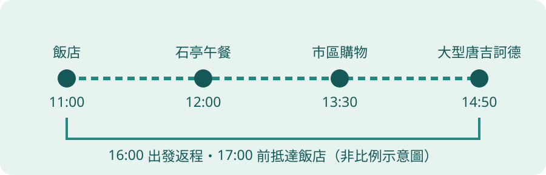

# 石垣島｜美食・購物半日行程

2026年12月1日（二）　8位大人＋1位嬰兒　Club Med Kabira 出差首日

行程原則：石垣牛午餐、市區購物、MaxValu 八重山店及大型唐吉訶德。以下皆為日本時間（台灣時間＋1小時）。午餐餐廳已選定；實際訂位與包車以確認為準。

## 車費收取通知（日幣）

包車（9位）¥56,200；停車費預估 ¥3,000（每小時 ¥500，共6小時）；合計 ¥59,200；九份均分約 ¥6,578。每人預收 ¥6,600 日幣，共 ¥59,400，預估餘額 ¥200，實際費用多退少補。收費地點：抵達 Club Med 飯店後。

## 01　行程總覽

| 時間 | 行程 |
|---|---|
| 上午 | 虎航抵達、搭接駁車回飯店、寄放行李、收取車費 |
| 11:30–12:20 | 飯店出發，前往石垣市區 |
| 12:30–13:30 | 滿天阿古豬・石亭 Sekitei 午餐 |
| 13:30–14:15 | Euglena Mall、公設市場、大國藥妝、甜點 |
| 14:15–14:30 | 前往 MaxValu 八重山店 |
| 14:30–15:00 | MaxValu 超市自由購物 |
| 15:00–15:10 | 前往大型唐吉訶德石垣島店 |
| 15:10–16:00 | 大型唐吉訶德自由購物 |
| 16:00–16:50 | 返回 Club Med，17:00 前抵達 |

車程為規劃估算，視交通提前返程。

[全程包車導航](https://www.google.com/maps/dir/?api=1&origin=Club%20Med%20Kabira%20Ishigaki&destination=Club%20Med%20Kabira%20Ishigaki&waypoints=%E6%BA%80%E5%A4%A9%E3%82%A2%E3%82%B0%E3%83%BC%20%E7%9F%B3%E4%BA%AD%20%E7%9F%B3%E5%9E%A3%E5%B8%82%E7%BE%8E%E5%B4%8E%E7%94%BA1-3%7CEuglena%20Mall%20Ishigaki%7CMaxValu%20Yaima%20Ishigaki%7C%E3%83%89%E3%83%B3%E3%83%BB%E3%82%AD%E3%83%9B%E3%83%BC%E3%83%86%20%E7%9F%B3%E5%9E%A3%E5%B3%B6%E5%BA%97&travelmode=driving) ｜ [市區步行導航](https://www.google.com/maps/dir/?api=1&origin=%E6%BA%80%E5%A4%A9%E3%82%A2%E3%82%B0%E3%83%BC%20%E7%9F%B3%E4%BA%AD%20%E7%9F%B3%E5%9E%A3%E5%B8%82%E7%BE%8E%E5%B4%8E%E7%94%BA1-3&destination=%E3%83%80%E3%82%A4%E3%82%B3%E3%82%AF%E3%83%89%E3%83%A9%E3%83%83%E3%82%B0%E7%9F%B3%E5%9E%A3730%E8%A8%98%E5%BF%B5%E7%A2%91%E5%89%8D%E5%BA%97&waypoints=Euglena%20Mall%20Ishigaki&travelmode=walking)

## 02　石垣牛午餐｜滿天阿古豬・石亭 Sekitei

已選定餐廳，12/1 12:30–13:30（日本時間，實際訂位時間以確認單為準），8位大人＋1位嬰兒。

農場直營日式鍋物，地址：沖繩縣石垣市美崎町1-3。午餐參考營業11:00–14:30。A5石垣牛御膳 ¥5,900／人，可選壽喜燒或涮涮鍋；純種阿古豬御膳 ¥3,400／人。八位成人全點石垣牛御膳 ¥47,200。

[官方午餐菜單與餐點照片](https://sekitei-agu.com/menu3/) ｜ [TableCheck 訂位資訊](https://www.tablecheck.com/en/sekitei-agu) ｜ [餐廳 Google Maps](https://www.google.com/maps/search/?api=1&query=%E6%BA%80%E5%A4%A9%E3%82%A2%E3%82%B0%E3%83%BC%20%E7%9F%B3%E4%BA%AD%20%E7%9F%B3%E5%9E%A3%E5%B8%82%E7%BE%8E%E5%B4%8E%E7%94%BA1-3)

電話：+81 50-1784-0930。確認九人座位、嬰兒椅或推車空間。

## 03　市區購物與美食

### 主要購物據點（步行自由活動）

Euglena Mall 商店街＋石垣市公設市場：有遮棚的商店街，集中當地食品、工藝、紀念品及市場小吃。

大國藥妝 石垣730記念碑前店：藥妝、保養品、日用品；參考營業時間10:05–21:50，免稅資格及當日時間以門市為準。

### 飯後甜點與小吃

石垣島プリン本舗｜鹽布丁、牛奶布丁、黑糖或紅芋口味。

Hau Tree Gelato｜熱帶水果冰淇淋，推薦鳳梨、百香果。

さよこの店｜沖繩炸甜甜圈（サーターアンダギー），下午可能售完。

かみやーき小｜八重山魚板，適合買來分享。

A&W 石垣店｜捲捲薯條、Root Beer 麥根沙士。

公設市場：金城製麵（八重山麵）、鮪魚及海鮮、島豬香腸等。小店營業與售完情況以現場為準。

### 推薦伴手禮與購物清單

地方限定食品：邊銀食堂石垣島辣油、石垣之鹽、ROYCE’ 石垣島限定黑糖／鹽味巧克力、八重山群島黑糖、島胡椒 Piparts、紅芋塔、金楚糕。

特色生活選物：琉球玻璃杯、石垣島 Genki 乳業周邊、島嶼風格手作小物。

藥妝採買：防曬、保濕、面膜、日常護理用品；藥品依個人需求及成分選購。免稅請攜帶護照，並確認食品及藥品入境限制；肉類及含肉加工品勿帶回台灣。

建議分流：13:30–13:50 公設市場與伴手禮；13:50–14:10 藥妝或甜點；14:15 集合上車。

## AEON MaxValu 八重山店

14:30–15:00，預留30分鐘。地址：沖繩縣石垣市真榮里292-1；參考營業時間24小時。推薦 TOPVALU 零食、Genki 乳品、沖繩黑糖、地方特產、熟食及壽司。

[Google Maps 導航](https://www.google.com/maps/search/?api=1&query=MaxValu%20Yaima%20Ishigaki)

## 04　大型唐吉訶德石垣島店

15:10–16:00，預留50分鐘，推薦藥妝、生活用品、零食及伴手禮；預留結帳及免稅時間。

[官方門市資訊](https://www.donki.com/store/shop_detail.php?shop_id=507) ｜ [Google Maps](https://www.google.com/maps/search/?api=1&query=%E3%83%89%E3%83%B3%E3%83%BB%E3%82%AD%E3%83%9B%E3%83%BC%E3%83%86%20%E7%9F%B3%E5%9E%A3%E5%B3%B6%E5%BA%97)

## 05　包車與預算

8位大人＋1位嬰兒，共9位乘客。包車11:30–17:00，確認嬰兒安全座椅與座位空間。

車費及停車費預估 ¥59,200；午餐若八位成人全點 A5 石垣牛御膳，預估 ¥47,200。合計 ¥106,400，不含其他餐飲與購物。車資預收不含午餐。

出發前確認：接駁及寄放行李、九人午餐、嬰兒安全座椅、日幣車資 ¥6,600／人、市區、MaxValu 及大型唐吉訶德集合地點。

[原始 Google 文件（可能尚未同步）](https://docs.google.com/document/d/11BoP2EWlB7yntGZHzIp8BxOi6Pe-ZHZ_vLzMjqSGF3g/edit)
